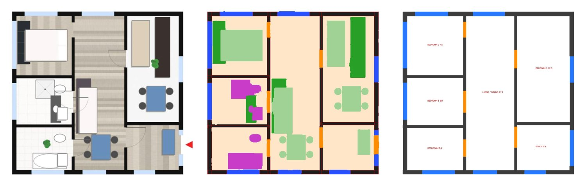
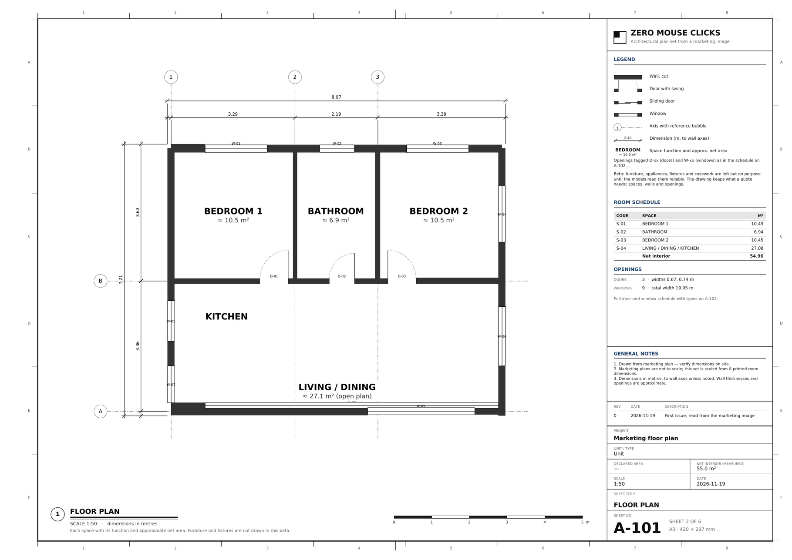
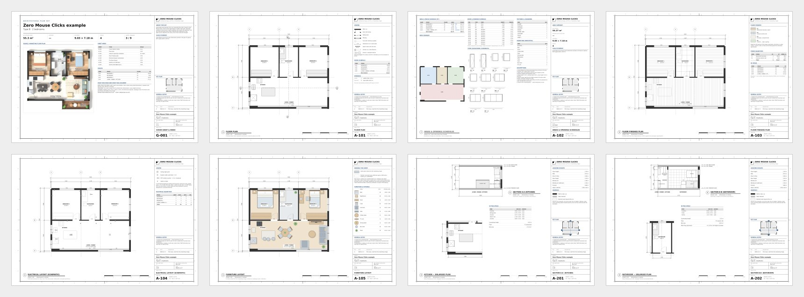
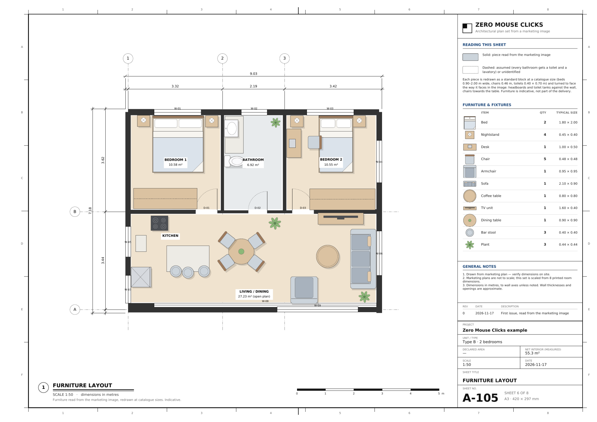

# Zero Mouse Clicks

**From a marketing floor-plan image to an architectural plan set. No cloud API, no LLM tokens.**

[Leer en español](README.es.md)

Developers and real-estate portals publish apartment floor plans as colorful images: furniture, wood floors, shadows, room names, a few dimensions. Zero Mouse Clicks reads one of those images and draws the plan set an architect would: walls, doors and windows, axes, chained dimensions, room areas, schedules, finishes, a schematic electrical layout, a furniture layout and two sections.

Everything runs on your own computer: three tiny segmentation models (ONNX, 0.8–1.3 MB each) plus explicit rules. The models were trained **only on synthetic floor plans** generated by code in this repository, so no third-party dataset license applies to the weights.

> **Status: research prototype (v0.3).** It works well on some plans and badly on others. Every sheet carries the note *"Drawn from marketing plan — verify dimensions on site"*, and it means it.



*Synthetic example included in [`examples/`](examples/). Left: input image. Middle: what the models see (walls, doors, windows, counters, fixtures, furniture). Right: the vector model after the rules.*



## What you get

One A3 PDF with eight sheets. Every sheet has an ISO 5457 frame with grid references, a title column (brand, a panel for that sheet, key plan, general notes, revisions, title block with a large sheet number) and a view title with scale bar; the largest standard scale that fits is used and the free space carries schedules and quantities.

| Sheet | Content |
|---|---|
| G-001 Cover & index | Key figures (net area, footprint, spaces, doors and windows), the source image, sheet index, space list, and what was read, measured or assumed |
| A-101 Floor plan | Walls, doors with swing, windows, axes with bubbles, chained and overall dimensions, room names and m², fixed casework and fixtures drawn as standard blocks; legend and room schedule |
| A-102 Schedules | Area & finish schedule with share bars and an area diagram, door & window schedule with schematic type elevations, fixtures, casework and furniture counts, assumptions |
| A-103 Floor finishes | Finish per room read from the image texture (wood, tile, porcelain, exterior), with swatches and quantities (m², perimeter) per finish |
| A-104 Electrical (schematic) | Rule-based proposal of light points, outlets, GFCI outlets and switches, with quantities per room. **Not** from the source plan |
| A-105 Furniture layout | Furniture and fixtures read from the image (bed, nightstand, sofa, armchair, dining table and chairs, desk, TV unit, stools, plants, appliances, sanitary fixtures), redrawn as parametric blocks at catalogue sizes, facing the right way, with floor tints. Indicative |
| A-201 Section, kitchen | Cut through the main counter (base and wall cabinets, hood, fridge; heights assumed) and an enlarged plan of the kitchen with fixture sizes and countertop length |
| A-202 Section, bathroom | Cut through the largest bathroom (fixtures, tiling, mirror; heights assumed) and an enlarged plan with fixture sizes. Toilets and lavatories always sit with their back against a wall |





## Quick start

```bash
git clone https://github.com/zeromouseclicks/zero-mouse-clicks.git
cd zero-mouse-clicks
pip install -e .

# private (net interior) area in m², as printed on the brochure
zmc examples/synthetic_54m2.png --area 54.4 -o plan-set.pdf --debug

# or let it read the area from the image (needs Tesseract, see below)
zmc my_plan.jpg
```

From Python:

```python
import zmc
result = zmc.plan_set("my_plan.jpg", "plan-set.pdf", area=47)
for room in result["fin"]["rooms"].values():
    print(room["name"], round(room["area"], 2))
```

Typically 8–35 seconds per plan on a CPU, depending on the machine and the image size. No GPU needed.

**Optional, recommended: [Tesseract OCR](https://tesseract-ocr.github.io/tessdoc/Installation.html)** (`apt install tesseract-ocr`, `brew install tesseract`, or the Windows installer). With it, the pipeline reads room names (Spanish and English), the declared areas and the printed room dimensions (`2.69 x 2.20`, `12'4" x 11'0"`), and uses the dimensions to set the scale. Without it, everything still runs and room types are inferred by rules.

Generate synthetic training plans with exact labels:

```bash
zmc synth -n 8 -o synthetic/ --style co   # styles: co (color brochure), us (3D top view), line (black & white)
```

## In the browser

[zeromouseclicks.com](https://zeromouseclicks.com) runs this same pipeline in the visitor's browser: Pyodide runs the `zmc` package, onnxruntime-web runs the three models and tesseract.js reads the texts. Nothing is uploaded and there is no server. The page loads `docs/app/` (built from `zmc/` and `web/` with `python web/build.py`; run it again after changing the package). The pipeline core (`zmc.pipeline.steps`) asks for model runs and OCR through a small generator protocol, so the CLI and the browser share one implementation.

## How it works

```
image ──► crop to the plan ──► 3 small U-Nets (ensemble, 3 resolutions) ──► 8-class mask
      ──► rules: wall-color filter · walls as orthogonal bars · openings = gaps between walls
                 · exterior (lawn, patio) by color · OCR labels and dimensions
                 · room types · casework and fixtures · floor finishes · electrical · sections
                 · furniture: type, catalogue size and facing of every piece → parametric blocks
      ──► vector model in metres ──► PDF (reportlab)
```

- **Models** (`zmc/models/`): U-Nets with separable convolutions, 190 k–330 k parameters. `unet_v2` and `unet_v3` read walls, doors and windows; `unet_v4` also reads counters/closets, fixed fixtures and loose furniture. The pipeline averages them. See [MODEL_CARD.md](MODEL_CARD.md).
- **Synthetic data** (`zmc/synth.py`): random apartments from rules, drawn in brochure styles (textured floors, furniture, colored backgrounds, labels and logos), with the pixel-exact label for free.
- **Scale** (`zmc/calib.py`): from the room dimensions printed on the plan when they agree with each other. Every printed dimension is compared with several clear spans measured on the image (face to face of walls, with and without closets, snapped to the wall color), in X and Y separately; the scale that explains most of them within ±3.5 % wins, so a wrong declared area cannot spoil it and a stretched image is corrected. Without printed dimensions, the declared area is used with its definition: private ≈ net spaces + half of the partitions; built / gross (and sq ft) ≈ footprint with walls. Sheet A-102 says which evidence was used and how well it agrees.
- **Rules** (`zmc/vectorize5.py`, `zmc/finish.py`, `zmc/sections.py`): every decision is explicit code you can read and change. This is deliberate: a wrong result can be traced to one rule.
- **Furniture** (`zmc/furnish.py`, `zmc/blocks.py`): the model only says *counter*, *fixture* or *furniture*; rules turn each blob into a piece (bed, nightstand, sofa, dining table and its chairs, stools along the island…), snap it to catalogue sizes (beds 0.90–2.00 m wide, tables, chairs), set where its front faces (headboard against the nearest wall or towards the pillows, sofa back to the wall, chairs towards the table) and draw it with a parametric block, in line style on A-101 and in colour on A-105.
- **Furniture bench** (`bench/`): hand-labelled pieces (type, box, facing) and `bench/eval.py`, which runs the pipeline and reports, per type, whether the model saw the piece, whether it was drawn with the right type, facing and size. See [bench/README.md](bench/README.md).
- **Training** (`training/train_gpu.ipynb`): runs on a free Kaggle or Colab GPU.

## Known limitations

Be honest with your users about these:

- Tested on **9 real marketing plans** from Colombian developers (not included: they belong to their owners) and on synthetic plans. Plans from other countries, black-and-white drawings and photos of paper plans are largely untested.
- Some rooms get the wrong type, especially without OCR (a bathroom read as a closet or a bedroom, a kitchen read as a bedroom; you can see both in the example above).
- Low-resolution images (under ~800 px) lose walls.
- Floor finishes are guessed from texture and are often wrong.
- Furniture (A-105) is drawn only where the model saw something, and the type comes from rules: on the furniture bench (92 labelled pieces, 4 plans) 49 % of the pieces get the right type and 94 % of those face the right way; on real developer plans it is about 30 %, with misses concentrated in kitchen and bathroom fixtures and in pieces the model does not see. A model trained on furniture types is the next step.
- Sections and electrical layouts are **schematic**: heights (2.45 m clear, 0.15 m slab, doors 2.10 m) and electrical points are assumptions, not information read from the image.
- No stairs, multi-level units or curved walls.
- Marketing plans are not drawn to scale. With printed room dimensions the plan is usually within 1–2 % (synthetic tests and the plans we tried); with only a declared area, it depends on how that area was measured, so type the private area when you can.
- Code comments are in Spanish (the project started in Colombia). Translations are welcome.

## Roadmap

- A one-tap correction screen (room type, a wall, an opening)
- DXF export
- More training styles (US listings, black-and-white plans) and a `v5` model
- A furniture model: typed furniture classes and orientation in the synthetic generator, so the model reads *bed*, *sofa*, *toilet* instead of *furniture*

## Contributing

Issues and pull requests are welcome, especially failing cases. Please **only share plans you own or have the right to share**; developer brochures are copyrighted. Describing the failure, with the debug image (`--debug`) of a plan you can share, helps most. See [CONTRIBUTING.md](CONTRIBUTING.md).

## License

[Apache License 2.0](LICENSE), for the code and the model weights. You can use, modify and redistribute it, also commercially, keeping the license and the [NOTICE](NOTICE). The software is provided "as is", without warranties: always verify dimensions on site. The license does not grant use of the "Zero Mouse Clicks" name.

Made by the Zero Mouse Clicks contributors. Questions or ideas: open an issue, or write from [zeromouseclicks.com](https://zeromouseclicks.com/#contact).
